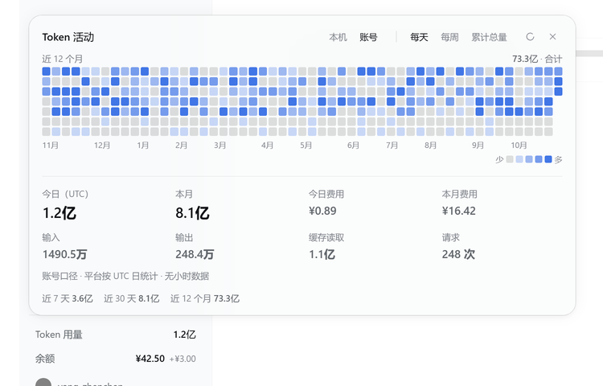

# dsh-balance

把 **DeepSeek 账户余额** 和 **Token 使用量**（GitHub 贡献图样式的年度热力图，支持 **本机 / 账号** 双数据源）固定在 DeepSeek Harness（DSH）侧边栏底部——账号头像的**正上方两行**。

> Balance row plus a token-activity heatmap for the DeepSeek Harness sidebar.



## 功能

### 余额行（下方一行）

- 显示账户充值余额；有赠金时在金额后追加 `+¥x.xx`。
- 页面可见时每 15 秒刷新；窗口重新获得焦点、从后台返回、账号登录状态变化、点击该行时都会立即刷新。
- 未登录显示「未登录」，读取失败显示「点击重试」；悬停可查看充值余额 / 赠金 / 更新时间。
- 余额通过本机 DSH Host 的 `account` Remote 读取（Platform `get_user_summary`），**账户 token 不会进入页面**。

### Token 用量行（上方一行）

- 显示**今日**已消耗的 token 总数（输入 + 输出 + 缓存读取 + 缓存写入），悬停可看今日拆分和近 7 / 30 天合计。
- 点击展开 **Token 活动** 面板：
  - 53 周 × 7 天的日历热力图，按用量深浅着色（含月份刻度与图例）；
  - 三档视图：**每天**（当日用量）、**每周**（整周合计，按列着色）、**累计总量**（从范围起点累加到当日的值）；
  - 数据源切换：**本机**（这台电脑的会话日志）/ **账号**（DeepSeek 平台账号级用量，换机器也能看）；
  - 本机视图：今日 24 小时时段分布条形图 + 今日输入 / 输出 / 缓存 / 请求 / 会话，以及近 7 天 / 近 30 天 / 总计；
  - 账号视图：今日（UTC）/ 本月用量、今日与本月费用（¥）、输入 / 输出 / 缓存 / 请求，以及近 7 天 / 近 30 天 / 近 12 个月；
  - 悬停任意格子可查看该日（或该小时）的用量与请求数；`Esc`、点击面板外或再次点击该行可关闭。
- 页面可见时每 60 秒刷新一次；展开面板时若数据超过 30 秒会立即刷新。

## 两个数据源

| | 本机 | 账号 |
| --- | --- | --- |
| 数据来源 | 本机 `~/.dsh/sessions` 会话日志 | DeepSeek 平台账号用量接口 |
| 覆盖范围 | 只算这台电脑上的 DSH | 账号下所有机器 / API Key 的用量（与平台控制台一致） |
| 时间粒度 | 精确到每次请求，支持 24 小时分布 | **只有按天**，且平台按 **UTC 日**切分 |
| 时间口径 | 跟随浏览器时区 | UTC（面板会标注） |
| 需要联网 | 否 | 是（Host 侧请求平台） |
| 费用 | 无 | 平台返回的人民币 / 美元费用 |

账号源使用 DSH 已登录的账户凭据读取平台用量接口；**凭据只在 Host 进程内使用，不会进入页面，也不会写进日志**。平台这组接口目前没有公开文档，属于“尽力而为”的增强：读取失败时面板会提示原因，可随时切回本机数据。

## 数据口径

- 本机：每个已结算的模型请求计一条样本，取 Provider 上报的 `inputTokens` / `outputTokens` / `cacheReadTokens` / `cacheWriteTokens`；`total` 为四者之和。
- 本机：同一步骤内流式样本会被最终样本替换；`llm/retry-started` 之后的重新请求会单独计入（与 DSH 自身的 token 账本一致）。
- 本机：压缩请求（`compaction/summary`）产生的用量也计入。
- 本机：Fork / 子代理会话的**继承历史**不重复计入（只统计该会话自己的事件）。
- 本机：日期与小时按浏览器上报的 UTC 偏移换算成本地时间，所以「今天」跟随你的时区。
- 账号：平台按 **UTC 日**、按模型汇总；输入取 `PROMPT_CACHE_MISS_TOKEN`，缓存读取取 `PROMPT_CACHE_HIT_TOKEN`，输出取 `RESPONSE_TOKEN`，请求数取 `REQUEST`；费用取 `/usage/cost`。平台不提供小时粒度。

## 要求

- DeepSeek Harness **0.2.x**（Desktop 或 Web 界面均可）
- 已登录 DeepSeek 账户（设置 → 账户）——余额与账号用量源都需要；本机用量源不要求登录

## 安装

### 方式一：在 DSH 插件页安装（推荐）

1. 打开侧边栏的 **插件** 页。
2. 在安装入口填入仓库地址：`https://github.com/yang-zhenchen/dsh-balance`
   （也接受 `github:yang-zhenchen/dsh-balance` 这种 pnpm 写法。）
3. 安装完成后确认 `dsh-plugin-balance` 已启用（安装默认启用）。
4. 侧边栏底部就会出现 Token 用量行与余额行。

### 方式二：手动 link（适合改代码）

```powershell
git clone https://github.com/yang-zhenchen/dsh-balance.git
cd dsh-balance
node scripts/enable-bundle.mjs
cd $env:USERPROFILE\.dsh\profiles\desktop
pnpm install
```

`enable-bundle.mjs` 只会把依赖和 `dsh.profile.bundles` 写进 profile 的 `package.json`（2 空格、无 BOM，并自动备份）。

> ⚠️ 不要用 `ConvertTo-Json | Set-Content` 之类的命令手动重写 profile 的 `package.json`：Windows PowerShell 会写入 UTF-8 BOM，导致 DSH 启动时 `JSON.parse` 失败、客户端直接打不开。已经遇到的话见下面的「启动失败」一节。

## 启动失败：`Unexpected token '' ... is not valid JSON`

**症状**：双击 DSH 客户端没有界面，日志里出现：

```text
SyntaxError: Unexpected token '', "{ ... " is not valid JSON
    at readProfileManifest (.../dsh-app-boot/lib/index.js)
```

**原因**：`~/.dsh/profiles/desktop/package.json` 被保存成了 **UTF-8 with BOM**。DSH 启动时会先读取这个 profile 清单，开头的 BOM 让 `JSON.parse` 直接失败，此时插件还完全没有加载——所以这不是插件运行时代码的问题。

常见来源：用 Windows PowerShell 的 `ConvertTo-Json | Set-Content -Encoding utf8` 手动改配置，或用带 BOM 的编辑器保存。DSH 插件页安装写入的是 2 空格、无 BOM 的 JSON，不会产生 BOM。

**修复（任选一种）**：

A. PowerShell（不需要 Node）：

```powershell
$p = Join-Path $env:USERPROFILE '.dsh\profiles\desktop\package.json'
$t = [System.IO.File]::ReadAllText($p)
if ($t.Length -gt 0 -and $t[0] -eq [char]0xFEFF) { $t = $t.Substring(1) }
[System.IO.File]::WriteAllText($p, $t, (New-Object System.Text.UTF8Encoding($false)))
```

B. 用本仓库的脚本（会先校验 JSON、再移除 BOM，并备份原文件）：

```powershell
node scripts/repair-profile.mjs
```

C. 用 VS Code 打开该文件，右下角编码选择 **Save with Encoding → UTF-8**（不要选 UTF-8 with BOM），保存后重启。

修复后重新启动 DSH 即可。其他 profile 把 `--profile desktop` 换成对应名字或目录。

遇到其他启动问题，可以在 [issue #1](https://github.com/yang-zhenchen/dsh-balance/issues/1) 里补充日志。

## 卸载

在插件页禁用或移除该 bundle；手动安装时执行：

```powershell
cd $env:USERPROFILE\.dsh\profiles\desktop
pnpm remove dsh-plugin-balance
```

并从 `dsh.profile.bundles` 中删除 `dsh-plugin-balance`。

## 实现

| 文件 | 作用 |
| --- | --- |
| [`cordis.patch.yml`](cordis.patch.yml) | 作为 bundle 向 profile 插入一个 `ui-balance` Loader 行 |
| [`lib/index.js`](lib/index.js) | 宿主侧：注册 `/dsh-balance/usage` 路由，索引会话日志 + 读取平台账号用量 |
| [`lib/usage.js`](lib/usage.js) | 纯函数：本机会话的样本折叠、按日 / 小时聚合（宿主与测试共用） |
| [`lib/account.js`](lib/account.js) | 纯函数：平台用量接口的解析、UTC 日聚合、按自然月窗口取数 |
| [`lib/client.js`](lib/client.js) | 浏览器插件：在 `sidebar.footer.action` 的一个槽位项里竖向排列用量行与余额行，并渲染用量面板 |

`sidebar.footer.action` 由 `@deepseek-ai/dsh-client-ui-sidebar` 渲染在 `sidebar.settings`（账号/头像行）的正上方，所以插件不需要改 DSH 源码，也不会和头像行抢位置。余额行同时订阅账户状态流，在登录 / 登出时立即同步。

本机用量由宿主侧通过 `ctx.sessionQuery` 读取会话日志：每个会话在本进程内只读一次，之后由 `session/event` 实时增量维护，浏览器只拿到聚合后的数字。账号用量由宿主侧从 `ctx.credentials` 取出 DSH 的账户 grant，带 `x-dsh-auth-token` 请求平台 `/api/v0/usage/amount` 与 `/usage/cost`，按自然月缓存（当月 5 分钟、历史月 6 小时），浏览器同样只拿到聚合结果。两种来源都走同一条路由，`source=local|account` 选择。

路由注册在 `ctx.webServer` 上，并先经过 `ctx.connection.requestRejection` 的 Host / Origin 与登录校验；没有 Web 服务或会话查询服务的环境（如 headless）只保留余额行。

## 开发

没有构建步骤：`lib/client.js` 本身就是 DSH Client Modules 可直接加载的 lazy-CJS 包。

```powershell
# 四组测试：浏览器渲染、本机聚合、账号解析、宿主路由
node test/smoke.mjs
node test/usage.mjs
node test/account.mjs
node test/host.mjs
```

修改 `lib/client.js` 后由 DSH 的 Client HMR 自动热更新（必要时刷新页面）；修改 `lib/index.js` / `lib/usage.js` / `lib/account.js` 需要重启 DSH。

## 已知限制

- 两行都跟随 DSH 侧边栏；侧边栏折叠时不显示。
- 轮询间隔固定（余额 15 秒、用量 60 秒），尚未做成可配置项。
- 本机源以 DSH 本地会话日志为准，不包含在 DSH 之外（如网页版 DeepSeek）产生的消耗；Provider 未上报用量的请求（如个别标题生成）无法统计。
- 账号源依赖平台未公开的用量接口，平台改版可能失效；只提供按天（UTC）数据，没有小时拆分；费用取平台 `cost` 接口的返回值。
- 首次打开（或重启 DSH 后）需要在后台索引历史会话，期间行内显示「正在统计…」，完成后自动补齐；账号源首次打开需要拉取约 13 个月的平台数据（之后走缓存）。

## License

[MIT](LICENSE)
